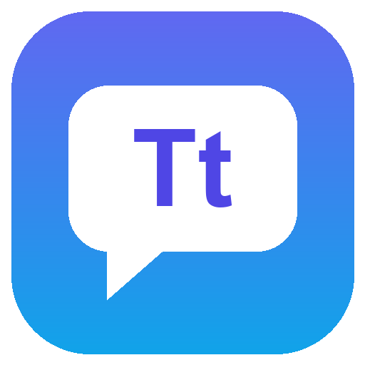

<div align="center">
  
  <h1>TranslaTone</h1>
  <p><strong>Translate anything with the right tone, straight from Raycast.</strong></p>
  <p>
    <a href="https://github.com/ayungavis/translatone/actions/workflows/ci.yml"></a>
    <a href="LICENSE"></a>
  </p>
</div>

## Why TranslaTone

Regular translators give you one literal result. Real messages need different voices: a LinkedIn note, a client email, and a WhatsApp reply should not sound the same. TranslaTone translates and adapts the tone in one step, using free providers.

## Features

- **Four tones**: Default, LinkedIn, Email, and Chat (Telegram/WhatsApp)
- **Two-way language pair**: set a main and second language (English ↔ Indonesian by default); text in your main language goes to the second, everything else to your main, and the result shows the detected direction
- **Translate Selection**: assign a hotkey, select text in any app, and it is replaced with the translation in your default tone, no window needed. With nothing selected, it opens Translate
- **Free providers with automatic fallback**: Groq → Gemini → Ollama
- **Usage at a glance**: see how much of each free quota you have used, counted locally with no extra requests
- **One keystroke flow**: tones are list rows (<kbd>↑</kbd> <kbd>↓</kbd>), <kbd>↵</kbd> pastes into the app you came from, <kbd>⌘</kbd> <kbd>↵</kbd> copies, <kbd>⌘</kbd> <kbd>S</kbd> swaps direction, and <kbd>⌘</kbd> <kbd>R</kbd> retries with the next provider

## Tones

| Tone     | Style                                                   |
| -------- | ------------------------------------------------------- |
| Default  | Faithful, natural translation like Google, Apple, DeepL |
| LinkedIn | Professional, warm, and concise                         |
| Email    | Polite and well structured, with greeting and sign-off  |
| Chat     | Short and casual for Telegram or WhatsApp               |

## Installation

1. Install TranslaTone from the [Raycast Store](https://www.raycast.com/ayungavis/translatone).
2. Open <kbd>⌘</kbd> <kbd>Space</kbd>, run **Translate**, and add at least one provider in the preferences.

## Providers

| Provider | Cost | Get a key                                           | Notes                                |
| -------- | ---- | --------------------------------------------------- | ------------------------------------ |
| Groq     | Free | [console.groq.com](https://console.groq.com/keys)   | Fastest; tried first                 |
| Gemini   | Free | [aistudio.google.com](https://aistudio.google.com)  | Used when Groq is limited or down    |
| Ollama   | Free | [ollama.com](https://ollama.com) (runs on your Mac) | Optional offline fallback, no limits |

When a provider returns a rate limit, no longer offers the configured model, times out, or is unreachable, TranslaTone moves to the next one and lists the skipped provider in the result. Invalid keys and rejected requests are reported instead of hidden.

> Gemini's free tier may use submitted text to improve Google's products. Avoid sending sensitive content through it.

### Usage tracking

Usage is counted on your Mac per provider, API key, and model. Changing the key or model starts a new counter, and counters reset every day. Limits shown are the published free-tier quotas and may drift from your account's actual limits; a provider's rate-limit response is always respected.

## Troubleshooting

When a translation fails, the error toast offers **Copy Debug Info**. It contains the providers tried, HTTP status codes, and request IDs, never your API keys. Include it when opening an issue.

## Development

Requirements: macOS, [Bun](https://bun.sh) 1.3+, Node.js 24+, and Raycast.

```bash
bun install
bun run dev
```

| Command            | Description                                   |
| ------------------ | --------------------------------------------- |
| `bun run dev`      | Run the extension in Raycast development mode |
| `bun run check`    | Format check, lint, typecheck, and tests      |
| `bun run test`     | Run unit tests                                |
| `bun run format`   | Format with oxfmt                             |
| `bun run lint:fix` | Fix lint issues with oxlint                   |
| `bun run build`    | Build the extension like the Raycast Store    |

### Project structure

```
apps/
  raycast/            Raycast extension (self-contained for the Raycast Store)
    src/core/         Translation logic with no Raycast dependency
    src/raycast/      Raycast adapters: settings, storage, UI components
packages/             Shared packages (reserved for upcoming apps)
```

## Releasing

Push a tag such as `v1.0.0`. The release workflow runs CI, creates a GitHub release, and opens a pull request to [raycast/extensions](https://github.com/raycast/extensions) for review.

One-time setup:

1. Fork `raycast/extensions`.
2. Add the repository variable `RAYCAST_EXTENSIONS_FORK` (for example `your-name/extensions`).
3. Add the secret `RAYCAST_PUBLISH_TOKEN`: a personal access token with `repo` and `workflow` scopes.

## Contributing

Contributions are welcome. Read [CONTRIBUTING.md](CONTRIBUTING.md) before opening a pull request.

## License

[MIT](LICENSE)
