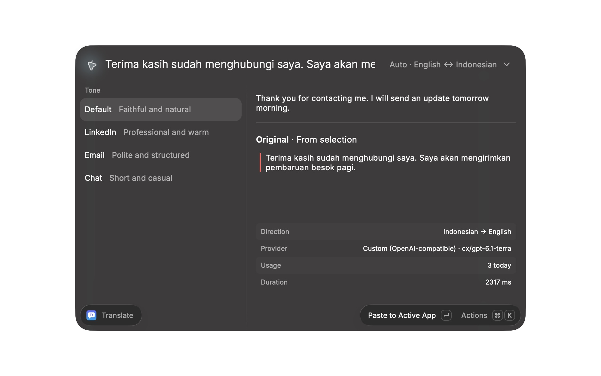

<div align="center">
  
  <h1>TranslaTone</h1>
  <p>Translate text with the right tone, straight from Raycast.</p>
  <p>
    <a href="https://github.com/ayungavis/translatone/actions/workflows/ci.yml"></a>
    <a href="LICENSE"></a>
  </p>
</div>

TranslaTone is a macOS Raycast extension for translating selected, typed, or clipboard text in Default, LinkedIn, Email, and Chat tones. It connects directly to configured AI providers and can fall back to another enabled provider.

See the [extension guide](apps/raycast/README.md) for setup, commands, providers, and privacy details.



## Development

The extension is available as a developer preview. Install [Bun](https://bun.sh) 1.3+, Node.js 24+, and [Raycast](https://raycast.com), then run:

```bash
git clone https://github.com/ayungavis/translatone.git
cd translatone
bun install
bun run dev
```

The self-contained Raycast extension lives in `apps/raycast`; its provider-independent logic is in `apps/raycast/src/core`.

Before submitting changes, run `bun run build` in `apps/raycast` to generate Raycast preference types, then `bun run check` at the root and `bun run lint` in `apps/raycast`. See [CONTRIBUTING.md](CONTRIBUTING.md) for the contribution guide.

## Releasing

A tag such as `v1.0.0` runs CI and creates a GitHub release. If `RAYCAST_EXTENSIONS_FORK` is configured, the release workflow also opens a pull request to [raycast/extensions](https://github.com/raycast/extensions) for review. Configure that repository variable with your fork (for example `your-name/extensions`) and the `RAYCAST_PUBLISH_TOKEN` secret with `repo` and `workflow` scopes.

## License

[MIT](LICENSE)
